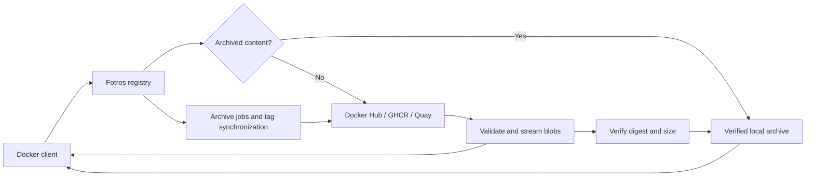

# Fotros Docker Mirror

Fotros Docker Mirror is an independent Docker/OCI registry implementation that mirrors public images from Docker Hub, GitHub Container Registry (GHCR), and Quay.io into a permanent local archive. It runs on Node.js with no runtime dependencies, build step, or external database.

It helps developers and organizations reduce their dependence on continuously available upstream registries and preserve images they have already downloaded. Unlike a disposable pull-through cache, Fotros retains verified manifests, layers, and previous image versions without automatic expiration. Self-hosting gives you control over storage, network access, and backups.

**Offline pulls require the requested manifests and blobs to have been archived.** A successful pull for one platform does not mean every platform has finished archiving.

Use the [public Fotros instance](https://docker-mirror.fotros.dev) or [run your own](#quick-start). This project is maintained under [Fotros](https://github.com/fotros-dev); it implements the registry itself rather than wrapping another registry server.

## Contents

- [Quick start](#quick-start)
- [Using the public Fotros instance](#using-the-public-fotros-instance)
- [Supported registries and image paths](#supported-registries-and-image-paths)
- [Using mirrored images in Docker Compose](#using-mirrored-images-in-docker-compose)
- [Features and request lifecycle](#features-and-request-lifecycle)
- [Archival, platforms, and synchronization](#archival-platforms-and-synchronization)
- [Self-hosted configuration](#self-hosted-configuration)
- [Docker Hub credentials](#docker-hub-credentials)
- [Optional authenticated push](#optional-authenticated-push)
- [Operations and API](#operations-and-api)
- [Production deployment](#production-deployment)
- [Offline behavior](#offline-behavior)
- [Storage and backups](#storage-and-backups)
- [Troubleshooting](#troubleshooting)
- [Testing and contributing](#testing-and-contributing)
- [Security and responsible usage](#security-and-responsible-usage)
- [License and related projects](#license-and-related-projects)

## Quick start

You need **Node.js 24.0.0 or newer** and Git. Linux is the verified server platform. Storage requires a local filesystem with POSIX permissions, hard links, atomic rename, and `fsync` support. Other operating systems have not been qualified; native Windows is not a supported deployment target.

There is no `npm install`, build step, Redis, PostgreSQL, or external registry server to provision. Docker Engine is needed only on a client that pulls or pushes images.

```bash
git clone https://github.com/fotros-dev/docker-mirror.git
cd docker-mirror
node src/main.js serve
```

No configuration is required. The server listens on **`127.0.0.1:5000`**, enables public upstream pulls and background synchronization, and disables push. It creates writable storage under the repository's `./data/` automatically. Configuration and storage paths resolve from the repository root even when the command runs from another working directory.

With the server running, verify it in another terminal:

```bash
node -e "fetch('http://127.0.0.1:5000/healthz').then(r => r.json()).then(console.log)"
node -e "fetch('http://127.0.0.1:5000/v2/').then(r => console.log(r.status))"
docker pull 127.0.0.1:5000/library/hello-world:latest
```

Health returns `{"status":"ok","service":"fotros-docker-mirror"}`; registry discovery returns `200`. Neither check proves upstream reachability or archive completeness. The first uncached pull needs upstream access. Loopback HTTP is suitable for local development; use HTTPS for a remote deployment.

Keep the server running while background archival completes. Check archive job states through [protected diagnostics](#operations-and-api) before relying on the image offline. Press `Ctrl+C` for a graceful shutdown.

## Using the public Fotros instance

To use `docker-mirror.fotros.dev`, pull an image by explicitly naming the mirror:

```bash
docker pull docker-mirror.fotros.dev/library/alpine:latest
docker pull docker-mirror.fotros.dev/library/node:24-alpine
docker pull docker-mirror.fotros.dev/library/postgres:17
docker pull docker-mirror.fotros.dev/library/redis:7-alpine
docker pull docker-mirror.fotros.dev/library/nginx:stable-alpine
```

GHCR and Quay use an additional registry prefix:

```bash
docker pull docker-mirror.fotros.dev/ghcr.io/astral-sh/uv:0.9.0
docker pull docker-mirror.fotros.dev/quay.io/prometheus/busybox:latest
```

These commands use the public mirror as their registry. A command such as `docker pull ghcr.io/astral-sh/uv:0.9.0` contacts GHCR directly. The public instance is a shared service, not private image storage; upstream restrictions and service availability still apply.

### Docker Engine registry mirror configuration

Docker Engine's `registry-mirrors` setting applies to Docker Hub. It does not automatically rewrite GHCR or Quay references. See [Docker's mirror configuration documentation](https://docs.docker.com/docker-hub/image-library/mirror/).

On a Linux host running Docker Engine, merge this into `/etc/docker/daemon.json`, preserving any existing settings:

```json
{
  "registry-mirrors": ["https://docker-mirror.fotros.dev"]
}
```

Restart Docker to apply it; plan for the effect on running workloads:

```bash
sudo systemctl restart docker
docker info --format '{{json .RegistryConfig.Mirrors}}'
docker pull alpine:latest
```

Docker Desktop users can edit the equivalent JSON in [Settings → Docker Engine](https://docs.docker.com/desktop/settings-and-maintenance/settings/#docker-engine) and apply the change.

With this setting, ordinary Docker Hub references such as `alpine:latest` can use the mirror. Docker Engine may fall back to Docker Hub when a mirror fails. An explicit reference such as `docker-mirror.fotros.dev/library/alpine:latest` selects Fotros directly and creates a differently named local image. Use explicit references when checking offline behavior. For official images, include `library/` explicitly after the mirror host; Fotros also normalizes single-component names, but Docker's own name handling differs when a registry host is present.

## Supported registries and image paths

| Upstream | Upstream image reference | Fotros Mirror reference |
| --- | --- | --- |
| Docker Hub, official | `docker.io/library/alpine:latest` | `docker-mirror.fotros.dev/library/alpine:latest` |
| Docker Hub, namespaced | `docker.io/grafana/grafana:latest` | `docker-mirror.fotros.dev/grafana/grafana:latest` |
| GHCR | `ghcr.io/astral-sh/uv:0.9.0` | `docker-mirror.fotros.dev/ghcr.io/astral-sh/uv:0.9.0` |
| Quay.io | `quay.io/prometheus/busybox:latest` | `docker-mirror.fotros.dev/quay.io/prometheus/busybox:latest` |

Replace the mirror host with your own host and optional port when self-hosting. Tags and canonical lowercase `sha256:` digests are supported. Use `<mirror>/<repository>@sha256:<digest>` to select a preserved revision by its actual digest.

Routing is deterministic:

- `ghcr.io/` and `quay.io/` select their respective upstreams and are removed from the upstream repository path.
- `local/` is reserved for authenticated, locally hosted images.
- Other repository names select Docker Hub. A single-component name such as `alpine` becomes `library/alpine`.

Do not add `docker.io/` after the mirror host: it is treated as part of a Docker Hub repository name. Likewise, `mcr.microsoft.com/`, ECR, GCR, and arbitrary registry prefixes do not enable additional connectors; they fall through to Docker Hub routing. Pull unsupported origins directly, or add a connector in source with its own routing, authentication, destination policy, and tests. There is no configurable arbitrary-upstream URL.

Disabling a connector blocks requests through that connector, including cached content, while leaving stored bytes intact.

## Using mirrored images in Docker Compose

Projects can use mirror references in ordinary `image` fields. For example, save this as `compose.yaml`:

```yaml
services:
  postgres:
    image: docker-mirror.fotros.dev/library/postgres:17
    environment:
      POSTGRES_USER: app
      POSTGRES_DB: app
      POSTGRES_PASSWORD: ${POSTGRES_PASSWORD:?Set POSTGRES_PASSWORD}
    volumes:
      - postgres-data:/var/lib/postgresql/data

  redis:
    image: docker-mirror.fotros.dev/library/redis:7-alpine

volumes:
  postgres-data:
```

Set `POSTGRES_PASSWORD` in your shell or the Compose project's `.env`, then run:

```bash
docker compose pull
docker compose up -d
```

Services on the Compose network can reach `postgres:5432` and `redis:6379`. This example consumes mirrored images; the [optional Docker deployment](#optional-docker-deployment) below runs Fotros itself.

## Features and request lifecycle

- **Three public upstreams:** Docker Hub, GHCR, and Quay, with explicit repository mapping and scoped upstream authentication.
- **Permanent content storage:** exact manifest/index bytes and opaque blobs stored by SHA-256, with deduplication and retained tag history.
- **Multi-platform archival:** recursive traversal of supported OCI indexes and Docker manifest lists, including platform manifests, configurations, and layers.
- **Background tag synchronization:** new revisions are archived before replacing an established tag; old revisions remain accessible by digest.
- **Streaming cache misses:** validated upstream headers are sent before the entire blob finishes downloading. Foreground capacity is reserved for client requests.
- **Recoverable downloads:** interrupted files can resume with validated upstream byte ranges; integrity checks gate permanent publication.
- **Optional private hosted images:** authenticated push and pull under `local/`, with repository permissions and protected administrative diagnostics.
- **Input and storage defenses:** fixed upstream destinations, DNS/redirect checks, validated paths, private file permissions, and verified immutable publication.

A request follows this lifecycle:

1. The client requests a manifest through the mirror. Fotros maps its repository to one upstream, or authorizes access to `local/`.
2. A tag resolves to its archived current digest, or its initial pending digest. A digest request selects that exact revision.
3. Fotros serves a locally archived manifest or fetches, validates, and preserves the missing manifest.
4. For an upstream image, it records the requested tag and schedules archival of the manifest's supported content graph.
5. Client blob requests use verified local content when available. Missing blobs are fetched into temporary storage and streamed after upstream response validation.
6. SHA-256 and size verification precede permanent content publication. A live response's final byte waits for successful publication.
7. Background workers archive remaining supported platform variants. Later tag synchronization archives new revisions while retaining the old ones.



The streaming path applies to blobs; manifests are read and validated before being returned. See [architecture and consistency](docs/architecture.md) for publication and recovery details.

## Archival, platforms, and synchronization

### Permanent archives and multi-platform images

Fotros supports OCI image manifests/indexes and Docker schema 2 manifests/manifest lists. It preserves exact manifest bytes and identifies content by digest. Shared content occupies one permanent content file, while repository membership remains separate.

When a client requests an index, Docker selects its platform manifest and requests its blobs. Those foreground requests receive scheduler priority and can promote queued downloads. In parallel, archive jobs visit every child represented by a supported manifest/index type, including nested indexes. The server does not need to run on the platform it archives, and it never executes images.

Job states are `pending`, `downloading`, `partial`, `complete`, `failed`, and `corrupted`. **Only `complete` means the required graph was verified with no recorded limitations.** Completing one client pull, receiving an index, or seeing a healthy server does not establish this.

Supported OCI artifacts are retained as opaque content and classified separately from runnable platforms. Unsupported descriptor types and missing external/nondistributable content leave a job partial. Descriptor `urls` are never followed; blobs are requested only through the selected registry. Subject references are preserved in manifest bytes but do not trigger additional graph traversal or referrers discovery. Graph safety limits are depth 16 and 10,000 descriptors.

There is no automatic expiry, eviction, retention policy, or valid-content garbage collection. Previous revisions remain stored when tags change.

### Tag synchronization

Synchronization is **enabled by default**, runs shortly after startup, and then checks previously requested upstream tags every **360 minutes**. Set `SYNC_INTERVAL_MINUTES` to change the interval, or `SYNC_ENABLED=false` to disable scheduled checks. Initial archival still runs when synchronization is disabled.

Checks prefer upstream `HEAD` and fetch a manifest when needed. A changed digest becomes a candidate archive. An established tag keeps serving its previous current digest until the candidate archive completes; publication then records the new digest and its archival time in tag history. Failed updates and upstream outages preserve the previous current version.

An initially requested tag can be served from its pending manifest before its first full archive completes. Cached tag pulls do not themselves revalidate the upstream, so tags can lag upstream changes. Use digest references for reproducibility.

Archive failures use backoff with jitter and respect longer upstream `Retry-After` delays. Automatic attempts are limited to six per job cycle; [the `retry` command](#operations-and-api) can start another cycle. Synchronization failures also retain diagnostics and a future retry time.

### Streaming and timeouts

A blob cache miss validates status, digest headers when supplied, advertised length, content encoding, and resume ranges before sending success headers. The verified manifest descriptor supplies the expected blob length, including for chunked upstream responses.

A shared transfer writes to disk while clients read available offsets with bounded buffers and backpressure. A slow or disconnected client does not cancel the shared archive transfer. The final byte of every live full or range response is withheld until the whole blob passes verification and publication. Earlier bytes are provisional; clients must verify the complete digest. Failure after headers aborts the response rather than completing a corrupt body.

Connection, response-header, overall header-budget, and idle-read timeouts are separate. Healthy active body transfers may outlive the header budget. Selected transient connection and upstream 5xx failures receive bounded retries with exponential backoff before body streaming; confirmed 404, authentication rejection, rate limits, and integrity/policy failures are not immediately retried. A later pull or archive attempt can resume an interrupted body.

Foreground slots improve responsiveness during background work, but upstream outages, server load, client deadlines, and proxy settings can still cause timeouts. Incoming request and idle client-socket limits are five minutes. See the [streaming engineering report](docs/engineering-report.md) for implementation details.

## Self-hosted configuration

The CLI automatically loads the optional repository-root `.env` using Node's `process.loadEnvFile()`. Existing process environment variables take precedence. You do not need to source the file. A missing file is allowed; malformed configuration stops startup.

To customize the defaults:

```bash
cp .env.example .env
chmod 600 .env
```

A minimal `.env` for a read-only server behind a local HTTPS proxy is:

```dotenv
HOST=127.0.0.1
PORT=5000
PUBLIC_URL=https://registry.example.com
PUSH_ENABLED=false
```

Replace `registry.example.com` with your domain. The remaining values can use defaults. Booleans accept exactly `true` or `false`; integers must be unsigned decimal values in the ranges below. Relative `DATA_DIR` values resolve from the repository root.

All application configuration variables are listed here. “Conditional” indicates a requirement when enabling a feature, rather than a requirement for default startup.

### Server, storage, and logging

| Variable | Default | Required | Description |
| --- | --- | --- | --- |
| `HOST` | `127.0.0.1` | No | Bind IP address or `localhost`. Push requires loopback. |
| `PORT` | `5000` | No | Listening port, 0–65535; `0` selects an ephemeral port. |
| `PUBLIC_URL` | `http://<HOST>:<PORT>` | Conditional | HTTP(S) origin without credentials, a path, query, or fragment. Set the external HTTPS origin behind a proxy; remote push requires HTTPS. This does not enable TLS on Node. |
| `DATA_DIR` | `data` | No | Must resolve to this repository's `data/` or a subdirectory of it. Mount external storage there; do not use a symlink. |
| `LOG_LEVEL` | `info` | No | Stderr threshold: `debug`, `info`, `warn`, `error`, or `silent`. JSON file logging continues at every level. |

### Upstreams and synchronization

| Variable | Default | Required | Description |
| --- | --- | --- | --- |
| `DOCKER_HUB_ENABLED` | `true` | No | Enable Docker Hub routing. |
| `GHCR_ENABLED` | `true` | No | Enable GHCR routing. |
| `QUAY_ENABLED` | `true` | No | Enable Quay routing. |
| `DOCKER_HUB_ACCOUNTS` | `[]` | No | JSON array of unique `username`/`token` profiles; see [credentials](#docker-hub-credentials). |
| `DOCKER_HUB_ACCOUNT_FAILOVER` | `false` | No | Select another eligible configured profile when enabled; subject to upstream policy. |
| `SYNC_ENABLED` | `true` | No | Schedule checks of tracked upstream tags. |
| `SYNC_INTERVAL_MINUTES` | `360` | No | Scheduled check interval, 1–525600 minutes. |
| `CONNECTIVITY_CHECK_ENABLED` | `true` | No | After network failures, probe fixed Cloudflare, Wikipedia, and Microsoft HTTPS endpoints for diagnostics. Also used by `doctor`. Cached pulls do not depend on probes. |

### Concurrency and size limits

| Variable | Default | Required | Description |
| --- | --- | --- | --- |
| `ARCHIVE_CONCURRENCY` | `2` | No | Concurrent archive jobs, 1–16. |
| `DOWNLOAD_CONCURRENCY` | `6` | No | Background capacity in each independent blob and manifest scheduler, 1–64. |
| `FOREGROUND_DOWNLOAD_CONCURRENCY` | `2` | No | Additional capacity reserved for foreground work in each scheduler, 1–64. |
| `MAX_BLOB_BYTES` | `107374182400` | No | Maximum fetched/uploaded blob size: 100 GiB by default; 1–9007199254740991 bytes. |
| `MAX_MANIFEST_BYTES` | `8388608` | No | Maximum manifest size: 8 MiB by default; 1024–67108864 bytes. |

### Upstream timeouts and retries

| Variable | Default | Required | Description |
| --- | --- | --- | --- |
| `UPSTREAM_TIMEOUT_SECONDS` | `120` | No | Legacy timeout setting; supplies the idle-read default when the explicit idle setting is absent, 1–3600 seconds. |
| `UPSTREAM_CONNECT_TIMEOUT_SECONDS` | `5` | No | DNS plus TCP/TLS connection deadline, 1–60 seconds. |
| `UPSTREAM_HEADER_TIMEOUT_SECONDS` | `10` | No | Response-header deadline per connection/hop, 1–120 seconds. |
| `UPSTREAM_HEADER_BUDGET_SECONDS` | `25` | No | Overall budget for upstream headers, authentication, redirects, and retries; also bounds foreground blob readiness waits, 1–120 seconds. |
| `UPSTREAM_IDLE_TIMEOUT_SECONDS` | `UPSTREAM_TIMEOUT_SECONDS`, otherwise `120` | No | Maximum idle gap during upstream body reads, 1–3600 seconds; not a total transfer-duration limit. |
| `UPSTREAM_RETRIES` | `2` | No | Additional attempts for eligible transient failures before streaming, 0–5, within the header budget. |
| `UPSTREAM_RETRY_BACKOFF_MS` | `250` | No | Initial retry backoff, 1–5000 ms; exponential delays are capped at 2000 ms. |

### Local authentication and push

| Variable | Default | Required | Description |
| --- | --- | --- | --- |
| `PUSH_ENABLED` | `false` | No | Enable authenticated writes under `local/` only. Requires loopback `HOST`, a suitable `PUBLIC_URL`, and at least one user with push permission. |
| `REGISTRY_USERS` | `[]` | Conditional | JSON user records with `username`, `passwordHash`, `permissions`, and optional boolean `admin`. Users can instead be persisted with the CLI. |

These limits bound individual operations and workers, not total disk consumption. There are no application environment settings for retention, platform filtering, arbitrary upstream origins, GHCR/Quay credentials, or TLS termination.

## Docker Hub credentials

Anonymous upstream access works without configuration. To assist public-image retrieval with Docker Hub accounts, use Personal Access Tokens (PATs):

```dotenv
DOCKER_HUB_ACCOUNTS='[{"username":"account-one","token":"<DOCKER_HUB_PAT_ONE>"},{"username":"account-two","token":"<DOCKER_HUB_PAT_TWO>"}]'
DOCKER_HUB_ACCOUNT_FAILOVER=false
```

Replace the placeholders with your own credentials. The accepted profile fields are `username` and `token`; use `token` rather than `password` or `pat`. Usernames must be unique and contain 1–128 letters, digits, dots, underscores, or dashes. Tokens must be nonempty strings of at most 4096 characters without CR/LF. There is no fixed profile-count limit.

In `.env`, single-quote the JSON value and use ordinary double quotes inside it, exactly as above. Do not add backslashes before those structural double quotes. If a value contains a double quote or backslash, escape it according to JSON rules. For a shell environment assignment, the same form works with `export DOCKER_HUB_ACCOUNTS='[...]'`. A JSON object wrapped in a double-quoted shell string would require shell escaping as well.

Selection is deterministic, not round-robin. With failover disabled, only the first profile is considered; if it is invalid or cooling down, retrieval falls back to anonymous access. With failover enabled, the first eligible configured profile is selected. It does not guarantee an immediate switch after a failed request.

The client exchanges a PAT for short-lived, repository-scoped Bearer tokens only at Docker Hub's trusted authentication endpoint. It records authentication state, safe quota headers, last failures, and rate-limit cooldowns. Diagnostics persist without PATs or Bearer tokens; authentication state is rechecked after restart. An invalid profile is excluded for that process, and 429 responses set a cooldown using `Retry-After`.

**Credentials do not enable private upstream mirroring.** Credential-assisted downloads first require anonymous upstream proof, and tag manifests are pinned to the digest proven public. Anonymous rate limits can therefore block new retrieval even when an account has remaining quota. GHCR and Quay use anonymous public access only.

Protect `.env` with restricted permissions, keep it out of Git, use appropriately scoped tokens, and restart after changes. Account failover is disabled by default and must not be used to circumvent provider restrictions. Multi-platform archival can consume more upstream quota than one platform pull; HTTP request counters are not provider pull counts. Consult [Docker's current pull accounting and limits](https://docs.docker.com/docker-hub/usage/pulls/) and applicable provider terms.

## Optional authenticated push

The public upstream mirror is read-only. A self-hosted instance can additionally host private organizational images under `local/`. Push is disabled by default, has no anonymous mode, and never writes to mirrored upstream namespaces.

With the server stopped, create a user:

```bash
node src/main.js user add alice 'local/team/*' --admin
```

The command prompts without echoing the password, requires 12–1024 password bytes, and stores a salted scrypt hash in `data/`. Use an exact repository such as `local/team/api` or a trailing `/*` prefix. The CLI creates both pull and push grants; `--admin` additionally permits diagnostics.

Then configure the server:

```dotenv
HOST=127.0.0.1
PORT=5000
PUBLIC_URL=https://registry.example.com
PUSH_ENABLED=true
```

Remote authentication requires a local HTTPS reverse proxy. Loopback HTTP is allowed for development. The application rejects a non-loopback bind when push is enabled and refuses startup without a user that has push permission.

Start the server, then use your own host:

```bash
docker login registry.example.com
docker tag my-api:1.0 registry.example.com/local/team/api:1.0
docker push registry.example.com/local/team/api:1.0
docker pull registry.example.com/local/team/api:1.0
```

Pull and push grants are independent. Every `local/` pull requires authorization; `admin` grants no implicit repository access. Upstream mirror pulls remain anonymous even when local push is enabled. To restrict those public reads too, use network or proxy access controls.

Manage persistent users while the server is stopped:

```bash
node src/main.js user list
node src/main.js user remove alice
```

Restart to apply changes. To manage users through configuration instead, generate a hash with `node src/main.js password` and set:

```dotenv
REGISTRY_USERS='[{"username":"alice","passwordHash":"<GENERATED_SCRYPT_HASH>","admin":true,"permissions":[{"repository":"local/team/*","actions":["pull","push"]}]}]'
```

Replace the hash placeholder with the complete generated value. Environment users override stored users of the same name; removing a stored user does not revoke an environment-defined record. Keep the single quotes in `.env` and avoid shell expansion of the hash's `$` characters.

Hosted publication verifies that referenced blobs and child manifests already belong to that repository. Upload sessions support chunks, status, resume, finalization, cancellation, and authorized local blob mounts. Completed manifests and blobs cannot be deleted through the API.

## Operations and API

Only one server or storage-maintenance CLI command may own a data directory at a time. **Stop the server before running these commands against its storage.**

| Command | Purpose |
| --- | --- |
| `node src/main.js serve` | Start the registry; also the default with no subcommand. |
| `node src/main.js status` | Print JSON with jobs, tag history, synchronization results, content usage, and metrics. |
| `node src/main.js doctor` | Run connectivity probes and report storage usage and metadata recoveries. |
| `node src/main.js sync` | Check tracked tags and wait for currently runnable archive work. |
| `node src/main.js verify` | Rehash associated stored content, report failures, and mark affected jobs corrupted; exits nonzero on failure. |
| `node src/main.js retry` | Reset eligible unfinished archive jobs for another attempt cycle and wait for runnable work. |

`sync` and `retry` can return while jobs remain deferred by backoff; inspect their state and resume the server for scheduled work. `verify` does not prove that a partial graph is complete. User-management commands also take the storage lock; `password` only generates a hash.

While the server runs, use the protected HTTP interfaces instead:

```bash
curl --user alice https://registry.example.com/admin/status
curl --user alice https://registry.example.com/admin/metrics
curl --user alice https://registry.example.com/admin/doctor
```

Curl prompts for the password. These endpoints require an administrator; create one through the user workflow even for a read-only mirror, leaving `PUSH_ENABLED=false`.

| Endpoint | Methods | Behavior |
| --- | --- | --- |
| `/healthz` | GET, HEAD | Public process liveness without repository details. |
| `/v2/` | GET, HEAD | Registry discovery; validates credentials if supplied. |
| `/v2/<name>/manifests/<tag-or-digest>` | GET, HEAD | Exact supported manifest/index bytes. PUT is available only for authorized `local/` publication. |
| `/v2/<name>/blobs/<digest>` | GET, HEAD | Blob retrieval, HEAD, and single/suffix byte ranges with 206/416 responses. |
| `/v2/<name>/tags/list` | GET, HEAD | Committed locally known tags, not an upstream catalog; `n` is 1–1000 and `last` paginates. |
| `/v2/local/<name>/blobs/uploads/` | POST | Start or complete an upload; authorized local mounts are supported. |
| `/v2/local/<name>/blobs/uploads/<id>` | GET, HEAD, PATCH, PUT, DELETE | Inspect, append, finalize, or cancel an upload session. |
| `/admin/status`, `/admin/metrics`, `/admin/doctor` | GET, HEAD | Administrative status, JSON metrics, and connectivity diagnostics. |

Logs are JSON lines in `data/logs/registry.jsonl` and, subject to `LOG_LEVEL`, stderr. Blob events include cache result, digest/provider, queue wait, upstream header latency, byte counts, duration, retries, and disconnects. Metrics persist every 30 seconds and on clean shutdown; an abrupt kill can lose recent counters or log records. Reported content usage excludes metadata, temporary files, and logs.

Schema 1, non-SHA-256 digests, catalog listing, referrers discovery, manifest/blob deletion, and multipart byte ranges are unsupported. The [verification notes](docs/verification.md) describe tested behavior and interoperability limits; full OCI conformance and end-to-end Docker Engine qualification are not claimed.

## Production deployment

### Node.js service and persistent storage

Run a single long-lived Node.js process under a dedicated, non-root account. Keep source and configuration read-only to that account after setup; only `data/` should remain writable. The service account and storage parents must not be writable by untrusted users.

The repository provides a [systemd unit](deploy/fotros-mirror.service) using `/opt/fotros-docker-mirror`, `/usr/bin/node`, and the `fotros` user/group. Adapt those paths and create the account before installation. Initialize storage once as that account while the service is stopped:

```bash
sudo -u fotros /usr/bin/node /opt/fotros-docker-mirror/src/main.js status
sudo cp deploy/fotros-mirror.service /etc/systemd/system/fotros-mirror.service
sudo systemctl daemon-reload
sudo systemctl enable --now fotros-mirror
sudo systemctl status fotros-mirror
journalctl -u fotros-mirror -f
```

The initial account must be able to create `data/`. The supplied unit grants writes only there, so create it before starting the unit. Set `HOST=127.0.0.1`, match `PORT` to the proxy, and set `PUBLIC_URL` to your external origin.

Use a persistent local disk mounted at `data/` or a subdirectory. Symlinks, multiple writers, shared containers with separate PID namespaces, and distributed/shared writable storage are unsuitable for this storage model. PM2 is an optional alternative: use one process in fork mode, the repository as `cwd`, `src/main.js` as the script, and `serve` as its argument. Do not use cluster workers sharing the archive.

### HTTPS and Nginx

Remote Docker clients normally require HTTPS with a trusted certificate. Obtain a certificate for your own domain, expose the proxy, and keep the Node backend on loopback. `PUBLIC_URL` describes that external origin; TLS terminates at the proxy.

A minimal Nginx configuration, adapted from [the supplied example](deploy/nginx.conf), is:

```nginx
server {
    listen 80;
    server_name registry.example.com;
    return 308 https://registry.example.com$request_uri;
}

server {
    listen 443 ssl;
    server_name registry.example.com;
    ssl_certificate /etc/letsencrypt/live/registry.example.com/fullchain.pem;
    ssl_certificate_key /etc/letsencrypt/live/registry.example.com/privkey.pem;
    ssl_protocols TLSv1.2 TLSv1.3;
    client_max_body_size 100g;
    client_body_timeout 300s;

    location / {
        proxy_pass http://127.0.0.1:5000;
        proxy_http_version 1.1;
        proxy_set_header Host registry.example.com;
        proxy_set_header Connection "";
        proxy_set_header X-Forwarded-Host "";
        proxy_set_header X-Forwarded-Proto "";
        proxy_set_header X-Forwarded-For "";
        proxy_request_buffering off;
        proxy_buffering off;
        proxy_cache off;
        proxy_next_upstream off;
        gzip off;
        proxy_connect_timeout 10s;
        proxy_read_timeout 900s;
        proxy_send_timeout 900s;
    }
}
```

Replace the domain and certificate paths, then validate and reload:

```bash
sudo nginx -t
sudo systemctl reload nginx
curl -fsS https://registry.example.com/healthz
```

Keep response buffering disabled to preserve streaming, request buffering disabled for uploads, and caching/compression/replay disabled as shown. Nginx's `proxy_read_timeout` measures gaps between reads, not the whole transfer; it does not extend Docker's response-header deadline. See [Nginx's proxy documentation](https://nginx.org/en/docs/http/ngx_http_proxy_module.html#proxy_read_timeout). Client and backend timeouts still apply.

The backend ignores forwarded headers and generates relative upload locations. Limit public traffic according to your capacity, keep credentials out of proxy logs, and expose only the intended HTTPS entry point.

For updates, stop the process, take a coherent backup, update source without deleting `data/` or `.env`, run the tests, and restart. Interrupted jobs and pending publications recover on startup. A clean restart preserves committed content and history. With PM2, restart the existing process with `--update-env` after changing exported environment variables.

### Optional Docker deployment

The existing [Dockerfile](Dockerfile) uses `node:24-alpine`, runs as the `node` user, and has no npm install step:

```bash
docker build -t fotros-docker-mirror .
docker run -d --name fotros-mirror --restart unless-stopped \
  -p 127.0.0.1:5000:5000 \
  -v fotros-mirror-data:/app/data \
  fotros-docker-mirror
```

The image binds `0.0.0.0` inside the container with push disabled; the command publishes it only on host loopback. Put HTTPS in front for remote use. The image does not include your `.env`; pass configuration with `-e`, or mount your protected file read-only at `/app/.env`. For a bridged read-only container, keep `HOST=0.0.0.0` in its process environment, overriding any loopback setting in that file. The volume must be writable by the container's `node` user (UID 1000). Preserve it across container replacement; no Docker socket mount is needed.

For authenticated push on Linux, use host networking, override `HOST=127.0.0.1`, and run the HTTPS proxy on the same host. A regular bridged container cannot expose its loopback-only backend to a separate proxy. This deployment path and live Docker-through-Nginx behavior require validation on your infrastructure.

## Offline behavior

The mirror itself and its storage must remain reachable. With the relevant connector still enabled, cached pulls do not wait for upstream checks or connectivity diagnostics.

| Archive state | Behavior when the upstream is unavailable |
| --- | --- |
| Complete supported image graph | Its archived manifests, configurations, and layers can be served locally, including after restart. |
| Previously committed/synchronized tag | Resolves to its last committed digest; failed updates do not remove that version. |
| Previously archived digest | Remains retrievable in its repository without resolving the upstream tag again. |
| Initial pending tag or partial archive | A stored manifest may be returned, but the pull fails if any required content is missing. |
| Cached platform, other platforms incomplete | That platform can work if its full dependency graph is local; an uncached platform still needs upstream access. |
| Missing manifest or blob | Fotros attempts upstream retrieval. Unavailable content cannot be supplied offline. |
| Corrupted content | Verification rejects it. Repair needs verified replacement bytes; archival status alone cannot overcome disk damage. |

Network failures and upstream 5xx responses generally produce `503 UPSTREAM_UNAVAILABLE` before response headers. A confirmed upstream 404 remains `404`; it is not reclassified as an outage. A blob without a known repository descriptor/association can also return `404`. Rate limits return `429`. An interruption after streaming begins closes the response short of its declared length.

Connectivity diagnostics can report `INTERNATIONAL_CONNECTIVITY_DISRUPTION` when all independent probes fail. This is a suspected broad outage, not proof of the cause. DNS, firewalls, and local routing can produce the same result.

Cached public images remain available even if upstream later deletes them or makes them private: archived requests deliberately do not revalidate upstream access. Account for that when defining your redistribution and access policies.

## Storage and backups

The default layout is:

```text
data/
  content/sha256/<digest-hex>                       # manifests, indexes, configs, layers
  state/<kind>/<key-hash>/<revision>-<hash>.json    # immutable metadata revision
  state/<kind>/<key-hash>/<revision>-<hash>.json.copy
  downloads/<digest-hex>.part                      # resumable upstream blob
  uploads/<uuid>.part                              # local upload session
  quarantine/<digest-hex>-<uuid>                    # replaced corrupt content
  logs/registry.jsonl
  owner.json                                      # exclusive process ownership
```

There is no separate external index/database. `state/` includes repository membership and tags, archive jobs, upload state, synchronization records, public provenance, users, metrics, and schema metadata. It is as important as `content/`; digest files alone cannot restore repository access or tag history.

Content is deduplicated by SHA-256 across repositories, while authorization remains repository-scoped. Files are verified before durable hard-link publication. Metadata has checksummed immutable revisions and independent copies for recovery. Defaults use directory mode `0700`, mutable file mode `0600`, and committed content mode `0400`. Backups must preserve ownership and permissions.

Interrupted upstream downloads survive as temporary files and may resume using a validated `Range` response. If upstream ignores ranges, the transfer restarts. Fully received temporary blobs can be verified and committed; invalid digest/size data is discarded. Temporary files are not valid archived content. Local upload recovery uses its persisted committed offset.

**Never delete `data/` during an update.** Full-platform archives, old image versions, metadata revisions, sessions, and logs grow without automatic cleanup or compaction. Monitor free bytes and inodes, not only the content-usage counter. There is no garbage-collection or retention command.

### Consistent backup and restore

Stop the service before an ordinary file-copy backup. For a Linux systemd installation, run the following as an operator who can read the archive, from the repository root. Use a private backup directory outside the repository:

```bash
(
set -eu
sudo systemctl stop fotros-mirror
umask 077
backup_dir="$HOME/fotros-mirror-backups"
mkdir -p "$backup_dir"
chmod 700 "$backup_dir"
backup_file="$backup_dir/data-$(date -u +%Y%m%dT%H%M%SZ).tar.gz"
sudo tar -C /opt/fotros-docker-mirror -czf - data > "$backup_file"
tar -tzf "$backup_file" > /dev/null
sudo systemctl start fotros-mirror
)
```

Continue only when the backup commands succeed. With another process manager, stop and start its single process instead. Save `.env` separately with equivalent protection. For a custom `DATA_DIR` under `data/`, copying all of `data/` also captures that store. A filesystem snapshot is an alternative only if it provides a coherent point-in-time view.

Restore the complete directory into the same repository-relative location while all writers are stopped. Preserve the existing directory until the restore is verified, restore service-account ownership and private permissions, and restore configuration separately. Do not overlay a backup onto a live store.

A lock copied from another host, an invalid `owner.json`, or an abandoned `owner-recovery` directory needs offline inspection. Remove a copied/stale lock only after establishing that no process owns the restored directory; dead-process locks on the same host normally recover automatically.

Run `node src/main.js verify` as the service account before restarting. Inspect job completeness as well, then test representative offline pulls. Retain the backup until those checks pass. Backups can contain private images and password hashes; protect them accordingly.

## Troubleshooting

Start with `/healthz` and protected `/admin/status`. Use `status`, `doctor`, `verify`, or `retry` CLI commands only while the server is stopped.

| Symptom | Likely source and next diagnostic step |
| --- | --- |
| `401 Unauthorized` | Local authentication is missing or invalid. Check `docker login`, the configured user, and password; `local/` and admin endpoints require credentials. Upstream credential rejection normally appears as 502/503 instead. |
| `403 Forbidden` | Fotros denied a repository action, admin access, or a write outside `local/`; a proxy can also deny access. Inspect the registry error body and exact permission path/action. |
| `404 Not Found` | Upstream confirmed absence, a blob has no repository association/descriptor, a local object is missing, or the API is unsupported. Check the routed name/tag and request its manifest before diagnosing a blob. |
| `429 Too Many Requests` | Upstream quota/cooldown or local authentication throttling. Respect `Retry-After`; inspect protected account/upstream metrics instead of repeatedly retrying. |
| `502 Bad Gateway` | Fotros can report rejected upstream auth, unsafe destination, or invalid metadata/digest; Nginx can report an unreachable backend. Compare the error body, Node logs, and proxy error log. |
| `503 Service Unavailable` | Network/upstream failure, disabled connector, damaged content, or exhausted capacity. Inspect `errors[].detail.reason`, job state, connector settings, and storage health. |
| `timeout awaiting response headers` | Docker or another client reached its header deadline. Compare `blob_request`/`blob_download` queue wait and upstream latency; verify the deployed streaming code, foreground capacity, and proxy buffering. Streaming avoids waiting for an entire healthy blob, but cannot remove network deadlines. |
| Upstream DNS/connection failures | Check DNS, outbound HTTPS, firewall, and connectivity diagnostics. The production transport rejects private addresses and does not use environment proxy settings. An outage is not a confirmed image-not-found result. |
| Digest or size mismatch | Upstream data or local storage failed integrity checks. Inspect safe error codes and disk health; stop and run `verify`, then repair/retry with upstream access. Do not manually mark the archive complete. |
| Insufficient disk space / `ENOSPC` | Check filesystem capacity and inodes, including metadata/logs/temporary files. Storage failures may surface as 500 or a truncated stream. Expand the mounted disk; do not delete arbitrary archive files. |
| Invalid environment configuration | Read the startup error. Check exact booleans, integer ranges, JSON quoting, `DATA_DIR` containment, and `PUBLIC_URL` origin syntax. Existing environment values override `.env`. |
| Docker Hub authentication failure | Check username, PAT validity/scope, and protected profile state. Restart after correcting configuration. Private upstream images remain unsupported, and anonymous proof must succeed. |
| HTTPS/certificate error | Check domain, certificate chain, expiry, client trust, and proxy/backend port. Setting `PUBLIC_URL=https://...` alone does not provide TLS. Keep plaintext authentication on loopback only. |
| Storage already owned / address in use | A server or CLI already holds the data lock or port. Use HTTP diagnostics while serving; stop the owner before maintenance. Never delete a live ownership lock. |

## Testing and contributing

The normal suite uses Node's native test runner and local HTTP fixtures. It requires no npm installation, public network, credentials, Docker daemon, or Go:

```bash
node --test
git diff --check
```

`npm test` is an optional alias for `node --test`, `npm start` starts the server, and `npm run verify` runs the offline storage verification command. npm is not required for the direct Node commands.

Tests cover routing, synchronization, offline restarts, multi-platform archives, streaming and backpressure, interrupted downloads, crash recovery, push authorization, integrity failures, and filesystem/network defenses. See [verification and release limits](docs/verification.md), [architecture](docs/architecture.md), and the [streaming engineering report](docs/engineering-report.md).

An optional live connector check is available:

```bash
node scripts/live-smoke.js
```

It contacts all three upstreams, fetches selected index/manifest/config content, downloads a layer only when within its 4 MiB smoke limit, and retains diagnostics under `data/live-smoke-*`. It does not establish that every platform is archived or replace a real Docker-client deployment test.

Contributions are welcome through [GitHub issues](https://github.com/fotros-dev/docker-mirror/issues) and pull requests. Describe the problem and resulting behavior, keep changes focused, add meaningful coverage for behavior changes, run the suite, and update configuration/deployment documentation when relevant. Preserve the zero-runtime-dependency design. Keep credentials and archive data out of commits.

## Security and responsible usage

This service downloads and stores untrusted OCI artifacts. It never executes images or extracts layers, needs no Docker socket, and can run without root. A matching digest proves byte integrity; it does not establish publisher trust, signature validity, or image safety. Do not run an untrusted image merely because it passed through the mirror.

The implemented boundaries include:

- Fixed HTTPS registry/authentication origins and provider-specific CDN allowlists, public-address validation of every DNS answer, pinned connection resolution, and redirect validation. Credentials are stripped across origins; token-endpoint redirects are rejected.
- Repository, tag, digest, request-path, and descriptor validation; hashed metadata keys; traversal and symlink defenses; private temporary files; SHA-256/size checks before immutable publication.
- Repository-scoped local authorization, owner-bound upload sessions, explicit source permission for local blob mounts, and public provenance checks before cross-repository content reuse.
- Anonymous upstream proof before Docker Hub credential assistance, so configured PATs do not expose private upstream images through the public mirror.

Run under a dedicated identity, protect configuration and backups, keep storage private, terminate remote authentication with HTTPS, and apply perimeter limits appropriate to your users. Public pulls consume bandwidth, disk, and upstream quota. These safeguards do not replace image scanning, independent security review, or capacity testing.

The [security model](docs/security.md) explains the boundaries. There is currently no dedicated vulnerability-reporting policy or private contact documented in this repository; do not include credentials or sensitive exploit details in public reports.

Upstream terms, authentication restrictions, pull-rate limits, and image redistribution rights remain applicable. Review the providers' current policies and each image's license before operating a shared archive. This project's source license does not grant rights to redistribute third-party images.

## License and related projects

Fotros Docker Mirror is licensed under the **Apache License 2.0**. See [LICENSE](LICENSE).

More from [Fotros](https://github.com/fotros-dev):

- [npm-mirror](https://github.com/fotros-dev/npm-mirror) — npm registry mirroring and package hosting.
- [apt-mirror](https://github.com/fotros-dev/apt-mirror) — caching proxy for apt repositories.
- [apt-registry](https://github.com/fotros-dev/apt-registry) — client-side apt mirror configuration.
